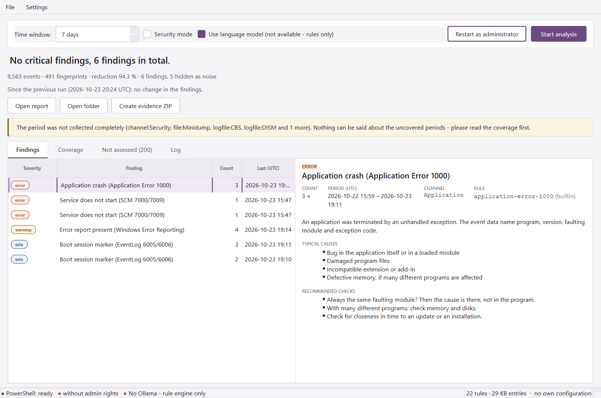
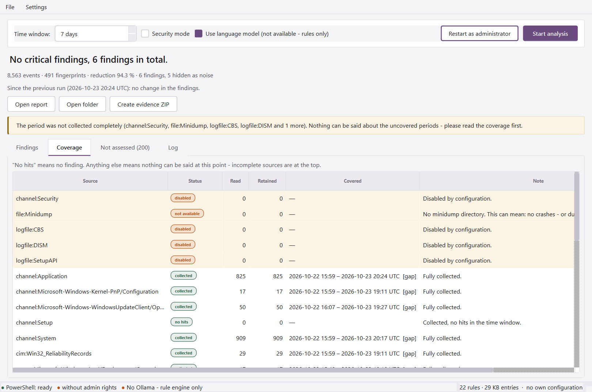

<p align="center"></p>

# WinEventAI

Local diagnostic tool for Windows. Reads event logs and further system
sources, condenses them technically, triages them by rules and can then let a
**local** language model explain the findings.

**Works without a language model.** Ollama is optional. Without it - not
installed, not running, model missing - every report is still complete: it is
built from the rule engine, and the report says so.

**Read-only.** The tool repairs nothing. A fix is only output as a suggestion:
command, expected effect, risk, rollback.

**Offline.** Apart from an optional one-time model download nothing goes to the
network. A call outside `localhost` is blocked without an explicit
`ai.allow_cloud: true` - and so is a model that the local Ollama only forwards
to a cloud service (for example `*:cloud` models).

---

## What the tool does

| Stage | Module | Task |
|---|---|---|
| 1 | `collect` | Raw records per source into a run directory, streaming; plus an error sweep over all other channels |
| 2 | `normalize` | Uniform event schema, language-neutral |
| 3 | `enrich` | Dedup, bursts, boot sessions, time-window correlation |
| 4 | `rules` | Deterministic triage, rules in YAML |
| 5 | `ai` | Explainer and correlator on the condensed finding (optional) |
| 6 | `probes` | Context probes: measure the current state related to a finding |
| 7 | `report` | HTML, Markdown, JSON from one shared model |
| 8 | `cli` / `gui` | Typer command line and PySide6 window |

The report is **complete without a language model as well**. The AI delivers
the last twenty percent; dedup, noise filter and knowledge base are the core.

## Download and start - no commands needed

1. Download **`WinEventAI-Setup-<version>.exe`** from
   [Releases](https://github.com/Felixitus/WinEventAI/releases/latest).
2. Double-click it. It installs for your user only - **no admin rights**, no
   Python, no Ollama needed.
3. Start **WinEventAI** from the start menu, choose the time window, click
   *Start analysis*.

For the Security channel and the security mode, click *Restart as
administrator* in the window; Windows shows its normal UAC prompt.

The executables are not code-signed, so SmartScreen may show "Windows
protected your PC" (*More info* → *Run anyway*). Compare the file with
`SHA256SUMS.txt` from the release first:

```powershell
(Get-FileHash .\WinEventAI-Setup-<version>.exe -Algorithm SHA256).Hash
```

| Download | For |
|---|---|
| `WinEventAI-Setup-<version>.exe` | Everyone: installer with start menu entry and uninstaller |
| `wineventai-<version>-win64.zip` | Portable use, e.g. from a USB stick: unpack, start `wineventai-gui.exe` |

Both contain the same two programs: `wineventai-gui.exe` (the window) and
`wineventai.exe` (the command line, optionally added to PATH by the
installer).

Your data - configuration, runs, reports - lives in
`%LOCALAPPDATA%\WinEventAI` and stays when you uninstall.

## Installation from source

WinEventAI is **not on PyPI**. It is installed from the project folder - the
directory that contains `pyproject.toml`.

```powershell
cd C:\path\to\WinEventAI          # pyproject.toml is here
py -m venv .venv
.\.venv\Scripts\Activate.ps1

pip install -e .                   # command line only
pip install -e ".[gui]"            # with the graphical user interface
pip install -e ".[dev]"            # with tests and linter (includes the GUI)
```

The dot at the end matters: it means "the package in this directory". Without
it pip searches PyPI and finds nothing or something else.

Shorter with the bundled script, which also removes an old installation and
checks the Python version:

```powershell
powershell -ExecutionPolicy Bypass -File .\install.ps1          # with user interface
powershell -ExecutionPolicy Bypass -File .\install.ps1 -NoGui   # CLI only
powershell -ExecutionPolicy Bypass -File .\install.ps1 -Venv    # into .venv
```

**Switching to a new version.** The old installation otherwise keeps pointing
to the old folder:

```powershell
pip uninstall -y wineventai
cd C:\path\to\the\new\version
pip install -e ".[gui]"
wineventai --version               # must show the new number
```

## Quick start

```powershell
wineventai doctor                      # check the environment BEFORE analyzing anything
wineventai run                         # collection + analysis, 7 days
wineventai run --days 30 --no-ai       # longer window, without model
wineventai run --security              # security mode (needs admin rights)
wineventai analyze --run <directory>   # re-analysis without collecting again
wineventai evidence --run <directory> --channel System --channel Security
```

`wineventai doctor` first: it checks each configured channel individually.
A filter on a non-existent channel would otherwise report "no findings" - the
worst kind of error in this tool. A missing Ollama is reported, but it is not
an error.

## Error sweep: every channel, critical and error only

The configured core channels (System, Application, Setup, WindowsUpdateClient,
Kernel-PnP) are read in full. In addition the **error sweep** reads every other
active Administrative/Operational channel - several hundred on Windows 11 -
filtered server-side to level 1 (critical) and 2 (error). That is where drivers
and components record their crashes without anyone configuring those channels
individually.

- One PowerShell process for all channels; measured on Windows 11 without admin
  rights: 146 channels, about 4,000 errors, 6 seconds.
- The script writes its plan first and a closing line per channel. A channel
  the sweep did not reach is "timed out", never "no hits".
- Channels without hits are counted in one summary row; every channel with hits
  or incomplete collection gets its own row in the coverage table.
- Events without a rule appear in the window's *Not assessed* tab and in
  `unknown_ids.csv` - with the original Windows message and the note "not on
  record", not as an empty field.

Configuration: `collect.error_sweep` (levels, channel types, exclusions, time
limit, retention cap).

## Graphical user interface

```powershell
pip install -e ".[gui]"    # in the project folder that contains pyproject.toml
wineventai gui
```

PySide6 (Qt, LGPL) is an **optional** dependency. The command line runs
without Qt - it is the way for servers, software distribution and sessions
without a graphical logon.

The window is a shell: it calls the same functions as the command line and
contains no diagnostic logic of its own. Otherwise GUI and CLI drift apart, and
in the end one debugs two tools.





Layout, in this order and for the same reasons as in the report:

| Element | Purpose |
|---|---|
| Run bar | Time window, security mode, language model on/off, *Restart as administrator* (only without admin rights), start and cancel |
| Headline | The one sentence that is read first, plus the change since the previous run |
| Action buttons | *Open report*, *Open folder*, *Create evidence ZIP* - after a run |
| Warning banner | Appears if the period was not collected completely |
| Tab *Findings* | List on the left (severity, name, count, last), detail on the right - with the probe results for the selected finding |
| Tab *Coverage* | Incomplete sources at the top, highlighted, with a visible note column |
| Tab *Not assessed* | Events without rule or verified knowledge-base entry, filterable, critical/error by default |
| Tab *Log* | The application log live during the run |
| Status bar | PowerShell, admin rights, Ollama state; long version in the tooltip |

If Ollama is not available, the checkbox reads *Use language model (not
available - rules only)*: the run still works, the report is built from the
rule engine.

## Context probes

A probe measures the **current** state for a **concrete finding**. It is not a
free-standing tool in a menu: whoever knows which button to press does not
need this program.

| Probe | Hangs on | Measures |
|---|---|---|
| `network` | DNS Client 1014, Dhcp-Client 1003, Tcpip 4227/4231, NetBT 4321 | Ping to DNS server, default gateway, DHCP server; plus a real name query |
| `service` | SCM 7000/7009/7031/7034 | State, start type, account and last exit code of the affected service |
| `storage` | disk 7/51/153, storahci/stornvme 129, Ntfs 55, volsnap 25 | Health, reliability counters, overall SMART status, free space |
| `time` | Time-Service 36/47/48/50/129/134 | W32Time state and source; the real offset by one SNTP request - only to time sources in the local network |

Five promises that define the scope:

- **No internet.** No speed test against a foreign service. It would break
  "works offline", "no telemetry" (the own IP would go to the provider) and
  "read-only" at once.
- **Local only, and enforced.** The script accepts no target address from
  outside; it reads the addresses from the IP configuration itself and skips
  every one outside the private ranges.
- **Only on the collected machine.** Whoever analyzes a server's run on a
  workstation gets no measurement but the sentence that it would describe the
  wrong machine.
- **The time gap has a consequence in the code.** A probe measures NOW, the
  finding arose BACK THEN. A "speaks against it" is downgraded to "says nothing
  about it" as soon as more than an hour lies in between.
- **Probes do not go into the prompt.** A measurement carries no event ids, so
  the evidence check cannot hold it against the input.

Switch off: `--no-probes` or `probes.enabled: false`.

## The run directory

The collector does not write into objects but into a directory; everything
after it reads only from there.

```
%LOCALAPPDATA%\WinEventAI\runs\2026-09-10T14-22-03Z_WS-4711\
  run.json                 time window, host, account, tool version, TZ offset
  sources.json             per source: status, covered period, figures
  raw\*.ndjson             one record per line, descending by time
  derived\groups.json      fingerprint groups
  derived\findings.json    rule hits
  derived\bundles\*.json   exactly what went to the model (after redaction)
  derived\ai\*.json        exactly what came back, plus verification result
  report\report.html|md|json
  unknown_ids.csv          work list for the knowledge base
  applog.jsonl             own application log, separate from the material
```

## The states that must never look alike

| Status | Meaning |
|---|---|
| `no hits` | Collected, nothing found in the time window. **That** is "no finding". |
| `not available` | The channel does not exist on this system. |
| `not logged` | Windows does not record the source on this system at all. |
| `no permission` | The source exists, the run lacked the permission. |
| `timed out` / `incomplete` | Only part of the period is available. |
| `failed` | The collection script returned no final status - nothing can be said. |

"No events" and "channel missing" are told apart by PowerShell's
language-neutral `FullyQualifiedErrorId` (`NoMatchingEventsFound` versus
`NoMatchingLogsFound`), never by the localized message. The coverage table
comes **before** the findings in the report.

## Configuration

```powershell
wineventai config path     # where is it looked for, what is present
wineventai config init     # create the user configuration
wineventai config show     # EFFECTIVE values after merging
```

The file in `%LOCALAPPDATA%\WinEventAI\` is **not created by itself**, and
`config init` writes it **completely commented out**. Only what you uncomment
takes effect; everything else stays tied to the bundled defaults.

YAML trap when uncommenting: the **parent key has to come along**:

```yaml
collect:
  days: 30
```

Precedence, weakest first: bundled defaults →
`%LOCALAPPDATA%\WinEventAI\wineventai.yaml` → `--config <file>` → CLI switches.

The time window is **never shrunk automatically**. A silently shrunken window
lets someone read "no findings" for a period that was never analyzed.

## Extending rules

Bundled rules live in the package, own ones in
`%LOCALAPPDATA%\WinEventAI\rules\*.yaml`. Merging is by `id`; the origin appears
in the report.

```yaml
- id: own-rule
  name: Example
  match:
    channel: System
    provider: Service Control Manager   # MANDATORY
    event_id: [7031, 7034]
  severity: error
  meaning: What is going on here.
  typical_causes: [Cause A, Cause B]
  recommended_checks: [What to check next]
  threshold: { count_min: 1, escalate_above: 20, escalate_to: critical }
```

`provider` is mandatory and enforced by the schema validator: event ids are
only unique per provider. Overlays written for versions before 2.0 (German
field names and severities such as `kritisch`) keep loading.

## Knowledge base

SQLite with FTS5 at `%LOCALAPPDATA%\WinEventAI\kb.sqlite`, key is
`provider + event_id`.

```powershell
wineventai kb list
wineventai kb search "stop code"
wineventai kb stats                          # completeness, with a work list of gaps
wineventai kb unknown --run <directory>      # work list from real cases
wineventai kb reseed
```

`confidence` has a consequence in the code: an entry without a verified
meaning is **not** embedded in the prompt. A database created by a version
before 2.0 is migrated in place on first use; entries you added yourself are
kept.

## Language model (optional)

### Setting the address

```yaml
# %LOCALAPPDATA%\WinEventAI\wineventai.yaml  - permanent
ai:
  base_url: "http://127.0.0.1:11434"
  model: "qwen2.5:14b-instruct"
```

```powershell
wineventai run --ollama-url http://127.0.0.1:11434   # once
wineventai doctor --model gemma4:26b                 # only check
wineventai run --no-ai                               # without model
```

Outside `localhost` - and for models Ollama forwards to a cloud service -
`ai.allow_cloud: true` is required in addition. That is intentional: redacted
findings then leave the examined system, and that should be a conscious
decision.

### "Not reachable" although the service is running

`wineventai doctor` tells the cases apart:

1. **Model not downloaded.** `doctor` then says "reachable" and lists the
   models present. Remedy: `ollama pull <model>` or set `ai.model`.
2. **Proxy in the environment.** WinEventAI bypasses the proxy for local
   addresses itself.
3. **Port or bind address.** `curl http://localhost:11434/api/tags` answers it.
4. **IPv6 versus IPv4.** `localhost` can resolve to `::1` while Ollama only
   listens on `127.0.0.1`. Then enter `http://127.0.0.1:11434`.

### Model choice: `wineventai ai bench`

```powershell
wineventai ai bench                          # every local model Ollama lists
wineventai ai bench -m gemma4:26b -m qwen3-coder:30b
```

The acceptance test sends three fixed scenarios (unclean restart after disk
retries, a crash series, a service killed by a driver) through the **real**
pipeline - rules, redaction, bundle, model, evidence check - and judges every
model by these gates, in this order:

| Gate | Threshold (`ai.bench`) |
|---|---|
| Context length the model supports | ≥ `min_context_length` (32,768); "unknown" fails |
| Schema-valid answer for every finding | all of them |
| Statements rejected by the evidence check | ≤ `max_rejected_share` (20 %); no statements at all also fails |
| Answers in English | stop-word heuristic, reported as such |

Among the passed models, all within `rejection_tolerance` (10 points) of the
lowest rejected share count as equally reliable, and the fastest of them is
recommended - one rejection more out of a few dozen statements is noise, a
factor of eight in run time is not. Speed and GPU offload are reported, not
judged. Models that cannot be tested
(missing, cloud without opt-in, embedding models) are listed as "not tested",
never as "failed". The command changes nothing: it prints a recommendation
(`ai.model: "..."`) and writes a JSON file with every answer to
`%LOCALAPPDATA%\WinEventAI\bench\`, so that the language can be read, not
only counted.

Every model statement carries structured evidence (`provider`, `event_id`,
`timestamp_utc`) that is checked against the input bundle. The single
statement is rejected, not the whole answer - and the report shows the
rejection instead of hiding it.

## Security mode

`--security` additionally evaluates 1102, 104, 4719, 4625 series, 4624 logon
type 10, 4720/4728/4732, 7045/4697, 4104/4103 and 4688 and looks for gaps in the
timeline (only **within** running sessions). Before that `auditpol` is queried:
if a subcategory is not active, the report says "not logged" instead of "no
finding". All results are explicitly marked as an **indication**, not a
forensic finding.

## Evidence

```powershell
wineventai evidence --run <directory> --channel System --channel Security
```

ZIP with original `.evtx` (`wevtutil epl`), normalized JSON, report,
`manifest.json` and `verify.ps1`. The checksum is taken over the `.evtx`
original. The bundle is **not** pseudonymized - it is evidence.

## Comparison with the previous run

Every analysis compares itself with the previous analyzed run of the same
machine: **new** findings, findings that became **more frequent** (per day,
because the time windows may differ) and findings **not seen in this
window** - deliberately not "resolved", because an absent event proves no
repair. The line appears in the window under the headline and in the report
above the findings. Thresholds in `report.compare`.

## Data protection and security

Event logs contain personal data (logon times, account names).
`--report-redacted` additionally writes a shareable version with stable
pseudonyms; the mapping table lies separately next to it.

All data lives in `%LOCALAPPDATA%\WinEventAI` - private to your user. Up to
2.2.0 it was `C:\ProgramData\WinEventAI`, where every local user may write
and read; a planted configuration could have redirected an administrator's
run. That folder is no longer read; see [SECURITY.md](SECURITY.md).

## Tests

```powershell
python -m pytest -q
ruff check src/ tests/
```

Everything from the collector's NDJSON reader onward is testable without
Windows and without a running Ollama. An `autouse` fixture fails every network
access in a test. The NDJSON fixtures deliberately contain German Windows
messages: they prove that nothing depends on localized text.

## Release

```powershell
.\packaging\build.ps1
```

Runs tests and linter, builds two executables from the same analysis -
`wineventai.exe` (console) and `wineventai-gui.exe` (no console window) - with
icon and version resource, puts the licence texts next to them, packs
`dist\wineventai-<version>-win64.zip`, builds
`dist\WinEventAI-Setup-<version>.exe` with Inno Setup 6
(`packaging\installer.iss`; `winget install JRSoftware.InnoSetup --scope user`)
and writes `dist\SHA256SUMS.txt`.

PyInstaller **one-dir**, not one-file: one-file unpacks to `%TEMP%` on every
start and looks like packer behavior to EDR. Without a code-signing
certificate SmartScreen remains; distribute via an internal share or software
distribution with the documented SHA-256.

## Licence

MIT - see [LICENSE](LICENSE). The release bundles Python, Qt/PySide6 (LGPL-3.0)
and further libraries; see [THIRD_PARTY_NOTICES.md](THIRD_PARTY_NOTICES.md).

## Non-goals of version 2

No automatic repair. No minidump parser. No agent, no fleet management. No
live monitoring. No cloud. No machine learning apart from the language model.
